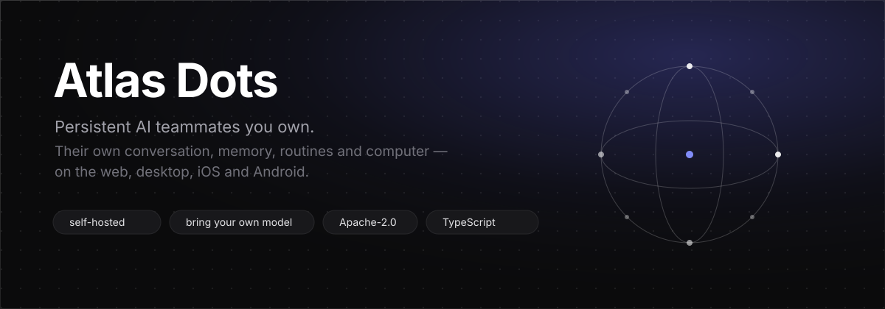

<p align="center">
  
</p>

<p align="center">
  <a href="https://github.com/codewith-aditya/atlas-dots/stargazers"></a>
  <a href="./LICENSE"></a>
  
  
</p>

**Atlas Dots** is a self-hosted platform for AI teammates that keep working after the chat ends.
Each bot is a persistent identity with one visible conversation, durable memory, routines, and its
own computer — a browser, a terminal, files and a desktop it can actually use.

Run it on your machine or a server. Bring your own model and sandbox provider, or run the whole
stack locally with Docker.

> **Status:** early and moving fast. Expect sharp edges; issues and pull requests are welcome.

---

## What a bot is

- **A teammate, not a chat.** It works in the background, comes back with a result, and asks for
  help only when it needs information, judgment, authorization, or a password.
- **It owns a computer.** A durable place with a browser identity, installed tools and files, so
  work survives a restart or a sandbox being replaced.
- **It keeps context.** Memory, routines, run history and messages live in your database — not a
  vendor's — and stay inspectable and exportable.

## Features

| | |
|---|---|
| **Persistent bots** | Own conversation, memory, routines, history, and a place in a shared Space |
| **Computers** | Shared Team computers or isolated Private ones: browser, terminal, files, graphical desktop, user takeover |
| **Channels** | Talk to a bot where you already are — iMessage, WhatsApp, Telegram, Slack and Lark |
| **Delegation** | Bots hand work to peer bots or short-lived subagents |
| **Models** | Bring your own credentials through Pi; any OpenAI-compatible provider works |
| **Voice** | Spoken replies, dictation and calls with your own ElevenLabs, OpenAI, Cartesia or Fish key |
| **Integrations** | Composio or Pipedream Connect catalogs, plus your own MCP servers, OpenAPI tools and Treg |
| **Sandboxes** | Docker, E2B, Daytona, CreateOS, Boat, Railway, or a trusted local machine |

## Quick start

Source checkout is the path that works today. You need Node.js 22.22.2+ (22.x), 24.x or 26+,
pnpm 9, and Docker.

```bash
git clone https://github.com/codewith-aditya/atlas-dots.git
cd atlas-dots
cp .env.example .env
```

Set `POSTGRES_PASSWORD` and `POSTGRES_APP_PASSWORD` (two `openssl rand -hex 16` values), put them in
`DATABASE_MIGRATION_URL` and `DATABASE_URL`, then set `BETTER_AUTH_SECRET`, `ENCRYPTION_KEY` and
`SCREEN_PROXY_SECRET` to independent long random values.

```bash
pnpm install
pnpm sandbox:build
pnpm dev
```

Open [http://127.0.0.1:5173](http://127.0.0.1:5173), create an account, connect a model, create a
bot. `pnpm dev` starts a local Postgres container when `DATABASE_URL` is not reachable, applies
migrations, and moves to free ports when the defaults are taken.

Published images (`ghcr.io/codewith-aditya/atlas-dots/app` and `.../computer`) are not out yet. The
compose files already read `ATLAS_DOTS_IMAGE` and `ATLAS_DOTS_COMPUTER_IMAGE`, so a mirror or a
local build works the same way.

## Run it on a server

Bots stay running when the backend lives on a server; connect from the desktop app, the mobile app,
or a browser.

```bash
git clone https://github.com/codewith-aditya/atlas-dots.git
cd atlas-dots
cp .env.example .env          # set ATLAS_DOTS_HOST=your.domain and your secrets
docker compose --env-file .env -f infra/compose/docker-compose.yml up -d --build
```

Put HTTPS in front of port 5173 — [production deployment](./docs/self-host-production.md) covers
Caddy and host hardening. Provider selection, backups and upgrades are in the
[self-hosting guide](./docs/self-host.md), [configuration](./docs/self-host-configuration.md),
[backups](./docs/self-host-backups.md) and [upgrading](./docs/self-host-upgrading.md).

## Desktop and mobile

The Electron and Expo apps are clients of the same API as the web app.

```bash
pnpm --filter @atlas-dots/desktop dev
```

On first run the desktop app asks whether to run Atlas Dots on this computer or connect to an
existing server. Public servers need HTTPS; HTTP is accepted for loopback and private LAN
addresses. Mobile build and release steps are in [docs/mobile-release.md](./docs/mobile-release.md).

The web UI ships in English, German, Korean, Turkish, Hindi, Portuguese (BR), Chinese (Simplified and
Traditional), Spanish, Russian, French, Hebrew, Dutch and Japanese under **Settings → Language**.

## Repository layout

```
apps/
  api/       Hono + oRPC backend: auth, jobs, realtime
  web/       React web client
  desktop/   Electron shell around the web client
  mobile/    Expo app for iOS and Android
  worker/    Background job runner
  www/       Marketing site (Astro)
packages/
  adapters/  Providers: models, sandboxes, messaging, integrations, memory, voice
  core/      Shared domain logic
  contracts/ Zod schemas and the typed RPC surface
  db/        Prisma schema, migrations, row-level security
  ui-web/    shadcn-based component library
infra/       Compose files, sandbox images, systemd units
```

Stack: TypeScript, React 19 + Vite + Tailwind, Electron, Expo, Hono + oRPC, PostgreSQL + Prisma,
Better Auth, Graphile Worker.

```bash
pnpm lint      # biome
pnpm check     # tsc across the workspace
pnpm test      # unit tests
```

## Documentation

- [Getting started](./docs/getting-started.md) · [Bots and chats](./docs/bots-and-chats.md)
- [Computers](./docs/computer.md) · [Computer runtime](./docs/computer-runtime.md) · [Groups](./docs/groups.md)
- [Integrations](./docs/integrations.md) · [Build a plugin](./docs/build-a-plugin.md) · [Memory](./docs/memory.md)
- [Self-hosting](./docs/self-host.md) · [Desktop app](./docs/desktop-app.md) · [Import an agent](./docs/import-an-agent.md)

## Contributing

Read [CONTRIBUTING.md](./CONTRIBUTING.md) before opening a pull request. For security issues use
[SECURITY.md](./SECURITY.md), not a public issue.

## License

Apache License 2.0 — see [LICENSE](./LICENSE).
